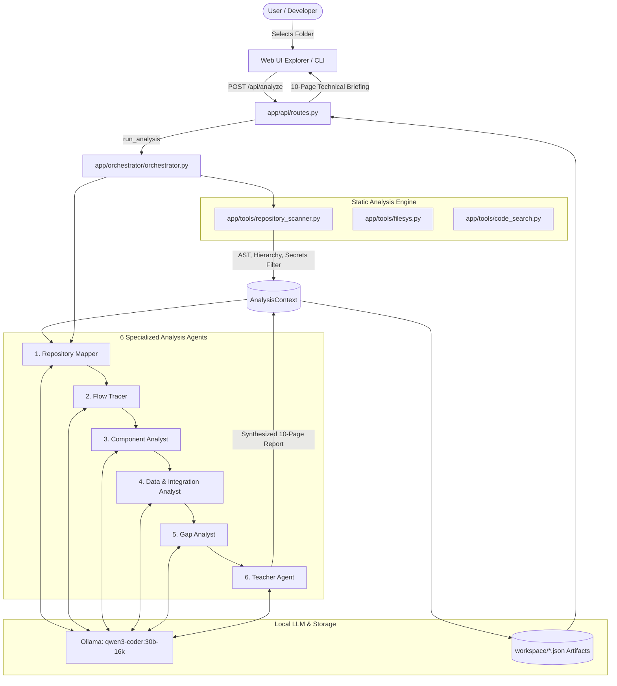

# 🔍 Sherlock: Local Multi-Agent Codebase-Understanding System

> *"Give me a deep, structured, understandable mental model of an unfamiliar codebase."*

Sherlock is an autonomous, local multi-agent system designed to analyze software repositories. Instead of acting like a generic conversational bot or writing random code, Sherlock coordinates a pipeline of 6 specialized analysis agents powered by a local Ollama LLM (`qwen3-coder:30b-16k`) and static AST code inspection to construct a 10-page mental model of any unfamiliar codebase.

---

## 🏗️ Architecture Diagram



---

## 🤖 The 6 Specialized Agents

Sherlock does not use disconnected chatbots. It runs a sequential pipeline where each agent consumes validated context produced by earlier agents:

| # | Agent | Responsibility | Core Output |
|---|---|---|---|
| **1** | **Repository Mapper** | Scans directory tree, entry points, configuration, dependencies, and tech stack layers. | `repository_map.json` |
| **2** | **Flow Tracer** | Discovers HTTP routes, API endpoints, CLI triggers, and step-by-step lifecycles (`INPUT ➔ ENTRY ➔ ROUTE ➔ CONTROLLER ➔ SERVICE ➔ DB ➔ RESPONSE`). | `flows.json` |
| **3** | **Component Analyst** | Analyzes what classes/functions *actually do* (distinguishing real behaviors from naming), inputs, outputs, side effects, assumptions, and failure modes. | `components.json` |
| **4** | **Data & Integration Analyst** | Maps databases, ORMs, schemas, file stores, external services, AI/LLM models, and data transformation pipelines. | `data_integrations.json` |
| **5** | **Gap Analyst** | Audits TODOs/FIXMEs, missing error handling, untested paths, security assumptions, and contribution opportunities. | `gaps.json` |
| **6** | **Teacher Agent** | The final synthesizer. Explains the codebase from first principles, answers the 25 core architectural questions, and provides an interview walkthrough. | `teaching_report.json` |

---

## 🎯 The 10-Page Technical Document

The final interactive report presented in the web UI and saved to disk covers:

1. **Page 1: Project Overview** &mdash; High-level identity, core purpose, tech stack, and entry points.
2. **Page 2: Repository Map** &mdash; Structural folder map, directory purposes, and directory tree.
3. **Page 3: Architecture** &mdash; High-level architecture diagram and key architectural decisions with trade-offs.
4. **Page 4: Routes & Interfaces** &mdash; HTTP endpoints, API contracts, and CLI parameters.
5. **Page 5: Execution Flows** &mdash; Step-by-step workflow diagrams with Mermaid sequence charts.
6. **Page 6: Component Explorer** &mdash; Deep dive into classes/functions (inputs, outputs, side effects, failure modes).
7. **Page 7: Data & Integrations** &mdash; Databases, external APIs, LLM models, and data movement pipelines.
8. **Page 8: Gaps & Issues** &mdash; Evidence-backed classification (`Confirmed issue`, `Likely issue`, `Architectural concern`, `Missing feature`, `Possible improvement`).
9. **Page 9: Concepts to Learn** &mdash; Foundational engineering paradigms required to master the repository.
10. **Page 10: Teacher / Learn the Project** &mdash; 25-question mental model, interview explanation, and recommended reading order.

---

## 🦙 Ollama Integration & Model Setup

Sherlock uses a local Ollama LLM backend to ensure **100% privacy** (no source code leaves your local workstation).

### Default Model Configuration
- **Model**: `qwen3-coder:30b-16k` (or any local Qwen / Llama code model)
- **Host**: `http://localhost:11434`
- **Configuration**: Configurable via `config.py` or environment variables:
  ```bash
  export SHERLOCK_OLLAMA_HOST="http://localhost:11434"
  export SHERLOCK_MODEL="qwen3-coder:30b-16k"
  ```

### Pulling the Model
```bash
ollama pull qwen3-coder:30b-16k
ollama serve
```

> **Resilient Fallback Mode**: If the local Ollama daemon is offline, Sherlock automatically uses its built-in AST synthesis engine to extract structure, classes, functions, and workflows from Python AST without failing or crashing.

---

## 🚀 How to Run

### 1. Launch the Web Interface
```bash
python -m app.main
```
Open your browser at `http://localhost:8000`. Enter the repository path and click **Analyze Codebase**.

### 2. Direct CLI Analysis
You can also run Sherlock directly against any folder via the terminal:
```bash
python -m app.main --analyze /path/to/target/repository
```

### 3. Self-Analysis (Sherlock Analyzing Sherlock)
```bash
python -m app.main --analyze .
```

---

## 📁 Output Artifacts

Every analysis run creates structured artifacts under `workspace/<analysis_id>/`:
- `repository_map.json`: Full structural map and tech stack.
- `flows.json`: Route catalog and execution sequence diagrams.
- `components.json`: Component behaviors and failure modes.
- `data_integrations.json`: Persistence and external boundary specs.
- `gaps.json`: Evidence-backed issues and contribution suggestions.
- `teaching_report.json`: Answers to all 25 developer mental model questions.
- `ten_page_report.json`: Complete serialized 10-page document.
- `README_ANALYSIS.md`: Standalone human-readable markdown briefing.

---

## 🔮 Future Contribution Mode

Sherlock V1 focuses on **read-only codebase understanding**. Its modular pipeline is designed so future extensions (such as an autonomous patch generator or test synthesizer) can simply consume `GapAnalysis` artifacts and produce verified pull requests without altering the core architecture.
