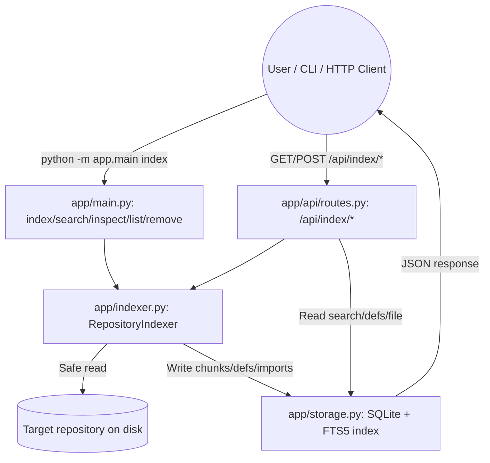

# SHERLOCK: COMPLETE ENGINEERING, SECURITY, AND FUNCTIONALITY AUDIT

**Repository:** `/Users/alisha/Desktop/sherlock` (on-disk case: `Sherlock`)
**Branch:** `main` (tracking `origin/main`)
**Commit:** `53cba0b` — "Add model-free codebase intelligence foundation (indexing, search, inspection)"
**Remote:** `https://github.com/codealisha99/sherlock.git`
**Audit date:** Tue Oct 20 2026
**Auditor role:** Principal software architect / senior backend / RAG / AppSec / reliability / QA

---

## 1. Repository Identity and Baseline Git State

### 1.1 Working directory and Git baseline

- Working directory: `/Users/alisha/Desktop/sherlock`
- Branch: `main`, up to date with `origin/main`
- Remote: `origin https://github.com/codealisha99/sherlock.git` (fetch + push)
- HEAD commit: `53cba0b` "Add model-free codebase intelligence foundation (indexing, search, inspection)"
- Prior commits: `3730d4e` "building the infrastructure", `33d6f99` "Initial project setup"
- Initial Git status: **clean working tree, nothing to commit**
- Final Git status (after audit): **clean working tree, nothing to commit**
- Changes caused by audit: none (all incidental temp files were removed; the `index/` SQLite DB created during verification was deleted and is gitignored)

### 1.2 Top-level repository layout

```
sherlock/
├── config.py              # Pydantic settings (Ollama optional, index DB path, limits)
├── README.md              # Documentation (describes Ollama-powered 6-agent pipeline)
├── requirements.txt       # 12 runtime dependencies (httpx, ollama, pydantic, ...)
├── .gitignore
├── app/
│   ├── __init__.py
│   ├── main.py            # CLI entrypoint: model-free subcommands + --analyze/--serve
│   ├── indexer.py         # Model-free repository indexer (SQLite + FTS5, stdlib AST)
│   ├── storage.py         # SQLite index store (repositories, files, chunks, defs, imports)
│   ├── api/
│   │   ├── __init__.py
│   │   └── routes.py      # BaseHTTPRequestHandler: /api/*, /api/index/* endpoints + SPA
│   ├── llm/
│   │   ├── __init__.py
│   │   └── ollama_client.py  # Ollama chat client (structured JSON, retry, fallback)
│   ├── orchestrator/
│   │   ├── __init__.py
│   │   └── orchestrator.py   # 6-agent sequential pipeline coordinator
│   ├── agents/
│   │   ├── __init__.py
│   │   ├── base.py            # BaseAgent + _query_model_with_fallback
│   │   ├── repository_mapper.py
│   │   ├── flow_tracer.py
│   │   ├── component_analyst.py
│   │   ├── data_integration_analyst.py
│   │   ├── gap_analyst.py
│   │   └── teacher.py
│   ├── analysis/
│   │   ├── __init__.py
│   │   ├── context.py         # AnalysisContext shared blackboard
│   │   ├── models.py          # Pydantic schemas for agents + 10-page report
│   │   └── artifacts.py       # ArtifactManager (JSON + Markdown to workspace/)
│   └── tools/
│       ├── __init__.py
│       ├── filesys.py         # SafeFilesystem (path traversal, secret, binary, size guards)
│       ├── repository_scanner.py  # RepositoryScanner (rglob + Python AST)
│       └── code_search.py     # CodeSearch (regex grep over scanned files)
├── frontend/
│   ├── index.html           # SPA (10-page briefing, Mermaid diagrams via CDN)
│   ├── app.js               # Frontend controller (polling, render, file viewer)
│   └── style.css
├── tests/
│   ├── __init__.py
│   ├── test_scanner.py      # SafeFilesystem, RepositoryScanner, CodeSearch
│   ├── test_llm_client.py   # OllamaClient JSON parsing/repair (unit, no network)
│   ├── test_orchestrator.py # Orchestrator end-to-end (static fallback, Ollama offline)
│   ├── test_agents.py       # All 6 agents (static fallback, Ollama offline)
│   ├── test_api.py          # SherlockRequestHandler (dummy socket, no network bind)
│   ├── test_indexer.py      # Model-free indexer (temp repos, no Ollama)
│   └── test_storage.py      # SQLite index store (temp DB, no Ollama)
└── workspace/               # Gitignored; prior 10-page report artifacts (analysis_*)
```

No `Dockerfile`, `docker-compose.yml`, `Makefile`, `pyproject.toml`, `setup.py`, CI config (`.github/`), or `CONTRIBUTING.md` exist.

### 1.3 What Sherlock is intended to do (per README vs. implementation)

**README claims:** An autonomous local multi-agent system powered by Ollama (`qwen3-coder:30b-16k`) + static AST that coordinates 6 specialized agents to build a "10-page mental model" of any codebase. Claims 100% privacy, local-only, optional static fallback when Ollama is offline.

**Implementation reality:** Sherlock is a **dual-mode, read-only, local codebase-intelligence tool**:

1. **Model-free mode (default, fully functional):** A SQLite + FTS5 indexer that scans a local repository, extracts Python AST symbols (functions, classes, methods, imports), chunks source for lexical search, and exposes CLI + HTTP endpoints to list/search/inspect/remove indexed repositories. Requires **no LLM, no Ollama, no network**.

2. **Ollama-powered mode (`--analyze` / `--serve`):** A sequential 6-agent pipeline (Repository Mapper → Flow Tracer → Component Analyst → Data & Integration Analyst → Gap Analyst → Teacher) that produces a 10-page JSON/Markdown briefing. Each agent calls Ollama for structured JSON, with a deterministic static-AST fallback when Ollama is unreachable.

Sherlock is **read-only**: it never executes repository code, never writes to the target repo, and (in model-free mode) never contacts a model provider.

---

## 2. Actual Architecture and Mermaid Diagrams

### 2.1 Technology stack (verified from source + requirements.txt)

| Layer | Technology | Source |
|-------|-----------|--------|
| Language | Python 3.10+ (venv runs 3.12.14; system python is 3.9.6) | `config.py`, `requirements.txt` |
| HTTP server | stdlib `http.server.ThreadingHTTPServer` (no FastAPI/uvicorn) | `app/main.py`, `app/api/routes.py` |
| Validation/serialization | Pydantic v2 | `app/analysis/models.py`, `config.py` |
| HTTP client (Ollama) | `httpx` | `app/llm/ollama_client.py` |
| Ollama client | `ollama==0.6.2` (installed, unused in model-free mode) | `requirements.txt`, `app/llm/ollama_client.py` |
| Index storage | SQLite (stdlib) + FTS5 full-text search | `app/storage.py` |
| Parsing | stdlib `ast` (Python only) | `app/indexer.py`, `app/tools/repository_scanner.py` |
| Frontend | Vanilla HTML/CSS/JS + Mermaid.js (CDN) | `frontend/` |
| Tests | stdlib `unittest` (no pytest installed) | `tests/` |

### 2.2 Model-free architecture (verified working)

```
Target Repository
      |
      v
app/tools/filesys.py  (SafeFilesystem: path-traversal, secret, binary, size guards)
      |
      v
app/indexer.py  (RepositoryIndexer)
      |- rglob traversal + ignore rules (.git, .venv, __pycache__, etc.)
      |- _index_file(): content hash, chunking (60 lines), Python AST extraction
      |- _remove_stale_files(): deletes records for files no longer on disk
      |
      v
app/storage.py  (IndexStore: SQLite + FTS5)
      |- repositories, files, chunks, chunk_fts (FTS5 external content)
      |- definitions, imports, index_log
      |- search_chunks(): FTS5 bm25 lexical search scoped by repo_id
      |- consistency_check(): orphan detection
```

### 2.3 Ollama-powered architecture (implemented; Ollama not running in this environment)

```
User (Web UI / CLI)
      |
      v (POST /api/analyze or python -m app.main --analyze)
app/api/routes.py  (SherlockRequestHandler, Background thread)
      |
      v
app/orchestrator/orchestrator.py  (Orchestrator.run_analysis)
      |- Stage 0: RepositoryScanner.scan() -> AnalysisContext (AST index)
      |- Stage 1..6: 6 BaseAgent subclasses, sequential
      |      Each agent: build_prompt(ctx) -> _query_model_with_fallback()
      |                  OllamaClient.generate_structured() -> Pydantic model
      |                  fallback: static synthesis from AST (no LLM)
      |
      v
app/llm/ollama_client.py  (OllamaClient: /api/chat, num_ctx, retries, JSON repair)
      |
      v
Local Ollama daemon (http://localhost:11434)  -- NOT running in this env
      |
      v (artifacts saved to disk)
app/analysis/artifacts.py  (ArtifactManager -> workspace/<id>/*.json + README_ANALYSIS.md)
      |
      v
GET /api/analysis/{id}/report  -> Frontend SPA (10-page explorer)
```

### 2.4 Mermaid: Request flow (model-free)



### 2.5 Mermaid: Request flow (Ollama-powered 10-page briefing)

```mermaid
flowchart TD
    User((User / Web UI))
    UI[frontend/index.html + app.js]
    API[app/api/routes.py: POST /api/analyze]
    Orch[app/orchestrator/orchestrator.py: Orchestrator]
    Scan[app/tools/repository_scanner.py]
    Ctx[app/analysis/context.py: AnalysisContext]
    A1[Agent 1: Repository Mapper]
    A2[Agent 2: Flow Tracer]
    A3[Agent 3: Component Analyst]
    A4[Agent 4: Data & Integration Analyst]
    A5[Agent 5: Gap Analyst]
    A6[Agent 6: Teacher]
    LLM[OllamaClient -> Local Ollama]
    Disk[(workspace/<id>/*.json)]

    User -->|Enter repo path| UI
    UI -->|POST /api/analyze| API
    API -->|background thread| Orch
    Orch -->|Stage 0| Scan
    Scan -->|AST index| Ctx
    Orch --> A1 --> A2 --> A3 --> A4 --> A5 --> A6
    A1 & A2 & A3 & A4 & A5 & A6 -->|generate_structured| LLM
    LLM -->|Structured JSON (+ static fallback)| Ctx
    Orch -->|save_all_artifacts| Disk
    Disk -->|GET /api/analysis/{id}/report| UI
```

---

## 3. What Happens When Sherlock Runs

### 3.1 Startup entry point

`app/main.py:main()` — prints a banner, builds an `argparse.ArgumentParser` with:
- Model-free subcommands: `index`, `search`, `inspect`, `definitions`, `imports`, `list`, `status`, `remove`, `summary` (each maps to a `cmd_*` function)
- Ollama-powered flags: `--analyze`/`-a`, `--serve`/`-s` (default `True`), `--host` (default `0.0.0.0`), `--port`/`-p` (default `8080`), `--open`

If a subcommand is given, `args.func(args)` runs the model-free command and exits. If `--analyze` is given, `_run_ollama_analyze()` runs. Otherwise `run_server()` starts the `ThreadingHTTPServer`.

**No model is loaded at startup.** `OllamaClient` is only instantiated lazily: inside `_run_ollama_analyze()` (model-free subcommands never import it) and inside `Orchestrator.__init__()` / `run_server()` (Ollama-powered path). `app/indexer.py` and `app/storage.py` never reference Ollama.

### 3.2 Configuration loaded

`config.py` instantiates a global `config = SherlockConfig()`. Settings:
- `ollama_host` default `http://localhost:11434` (env `SHERLOCK_OLLAMA_HOST`)
- `model_name` default `qwen3-coder:30b` (env `SHERLOCK_MODEL`; README still says `qwen3-coder:30b-16k` — stale)
- `timeout_seconds` default `120` (env `SHERLOCK_TIMEOUT`)
- `max_retries` default `2`
- `max_file_size_bytes` default `150_000`
- `max_files_to_index` default `2500`
- `max_tokens_per_prompt` default `14_000`
- `context_window` default `16_384` (passed to Ollama as `num_ctx` only when LLM used)
- `index_db_path` default `<repo>/index/sherlock.db`
- `ignored_dirs`, `ignored_patterns` (secrets), `binary_extensions`
- `base_dir`, `workspace_dir`

### 3.3 Services/clients that initialize

- Model-free subcommands: only `IndexStore` (SQLite connection, lazy) and `SafeFilesystem`. No network, no LLM.
- `run_server()`: instantiates `Orchestrator()` which instantiates `OllamaClient()` and all 6 agents **immediately** (agent constructors each create an `OllamaClient` if none passed). No network request is made at construction; the first `check_health()` occurs on `/api/health` or the first agent `run()`.
- `OllamaClient.check_health()` makes a `GET /api/tags` to the Ollama host (3s timeout).

### 3.4 Whether Ollama is required

**No.** Ollama is optional. In model-free mode it is never imported or contacted. In Ollama-powered mode, every agent calls `_query_model_with_fallback()`, which calls `check_health()`; if Ollama is unreachable, a deterministic static-AST fallback is used instead of crashing. This fallback is exercised by the test suite (Ollama not running; all tests pass).

### 3.5 Network requests during startup

None in model-free mode. In Ollama-powered server mode, `Orchestrator()` construction does **not** make a network request. The first network contact is `check_health()` on `/api/health` or during an agent run. No telemetry, no update checks, no cloud fallback.

### 3.6 Repository selection

Supplied by the user as a filesystem path:
- CLI: `python -m app.main index /path/to/repo`
- HTTP: `POST /api/index` with JSON `{"project_path": "/path/to/repo"}`
- Ollama mode: `POST /api/analyze` with `{"project_path": ...}` or `--analyze /path`

The path is `Path(...).resolve()`; must exist and be a directory.

### 3.7 File discovery, filtering, reading

`app/tools/filesys.py:SafeFilesystem` + `app/tools/repository_scanner.py:RepositoryScanner`:
- `root.rglob("*")` traversal
- Skips: ignored dirs (`.git`, `.venv`, `__pycache__`, `node_modules`, `build`, `dist`, etc.), `.git` explicitly, symlinks whose target resolves outside root (`_should_skip`)
- Skips binary files (extension or null-byte check in first 1024 bytes), secret files (`.env`, `*.key`, `credentials.json`, `id_rsa*`, etc.), files > `max_file_size_bytes` (150 KB)
- Reads UTF-8 with `errors="replace"`, truncates at `max_file_size_bytes`
- `resolve_path()` enforces `Path.resolve().relative_to(root)` — blocks path traversal
- Reads only; never executes, never follows external symlinks

### 3.8 Parsing, chunking, indexing, storage

- Python files are parsed with `ast.parse()` into `RepositoryIndex` (top-level functions, classes, methods, imports; route decorator heuristics)
- All text files are chunked into 60-line blocks with `start_line`/`end_line`
- Persisted to SQLite (`index/sherlock.db`) with tables: `repositories`, `files`, `chunks`, `chunk_fts` (FTS5 external-content, `unicode61` tokenizer), `definitions`, `imports`, `index_log`
- FTS5 `bm25` lexical search scoped by `repo_id`
- Re-indexing is idempotent: same `path` reuses the repo row; per-file content replaced; stale records (files no longer on disk) removed
- `consistency_check()` detects orphaned chunks/definitions/imports

### 3.9 How a user query travels (model-free search)

`GET /api/index/search?repo_id=<id>&query=<term>&limit=20`
1. `IndexStore.search_chunks()` builds an FTS5 query: `"term1*" OR "term2*"` (prefix matching)
2. `MATCH` against `chunk_fts`, joined to `chunks` + `files`, filtered by `repo_id`
3. Ordered by `bm25(chunk_fts)`, limited
4. Returns `content`, `file_path`, `start_line`, `end_line`, `rank`

There is **no semantic/vector search, no embedding model, no hybrid retrieval, no re-ranking**. It is pure lexical FTS5.

### 3.10 Citations and source references

Search results include `file_path`, `start_line`, `end_line`, and the matched `content` chunk. The `inspect` endpoint returns line-numbered source (`{line}| {content}`). These are direct byte/line references from the indexed file — accurate to the indexed content, but there is **no citation-validation step** and no grounding against the live filesystem at query time (the index could be stale if files changed without re-indexing).

### 3.11 Failure, timeout, retry, cancellation handling

- Per-file errors during indexing are caught individually; the run continues, recording the file in `skipped_files`/`errors` (never crashes the whole index)
- `OllamaClient.generate_structured()` retries up to `max_retries + 1` (default 3) on `JSONDecodeError`/`ValidationError`, with a self-correction prompt; `httpx.ConnectError` is re-raised immediately (no retry on connection failure)
- Ollama calls use `httpx.Client(timeout=self.timeout)` default 120s
- No cancellation token; background indexing threads are daemon threads
- `read_file()` catches exceptions and returns an `[ERROR reading file: ...]` string rather than raising

### 3.12 Repository updates, deletion, re-indexing

- Re-index: call `index_repository()` again on the same path — idempotent, replaces changed files, removes stale ones
- Delete: `remove_repository(repo_id)` deletes the `repositories` row; SQLite `ON DELETE CASCADE` removes `files`, `chunks`, `definitions`, `imports`, `index_log` rows. FTS5 mirror rows are deleted explicitly in `delete_chunks_for_file()` before file deletion (external-content table does not auto-cascade)
- HTTP `DELETE /api/index/repos/{id}` exposes removal
- There is **no incremental "only changed files" detection** beyond re-scanning and comparing content hashes; a full re-scan occurs on each re-index

### 3.13 Shutdown

`httpd.serve_forever()` until `KeyboardInterrupt`, then `httpd.shutdown()`. SQLite connections are closed via `IndexStore.close()` / `finally` blocks. No model to unload in model-free mode. Ollama-powered mode makes no persistent model reservation, so stopping the server releases the Python process; the Ollama daemon (if running separately) is unaffected.

---

## 4. Functional Inventory

| Capability | Status | Evidence | Files |
|------------|--------|----------|-------|
| Installation / dependency resolution | Verified working | `pip list` shows all 12 deps installed in venv; `import app.*` succeeds | `requirements.txt`, `.venv/` |
| Startup (CLI model-free) | Verified working | `python -m app.main index` ran successfully without Ollama | `app/main.py` |
| Startup (web server) | Verified working | Server started on `127.0.0.1:18080`; `/api/health` returned 200; `/` served `index.html` | `app/main.py`, `app/api/routes.py` |
| Health check | Verified working | `/api/health` returns `{"status":"ok","ollama":{...}}` (reports Ollama unavailable when offline) | `app/api/routes.py:58` |
| Configuration validation | Implemented, not verified | Pydantic model with defaults + env overrides; no explicit validation CLI | `config.py` |
| Repository selection | Verified working | CLI index accepts path arg; errors on nonexistent path (tested) | `app/main.py:58`, `app/indexer.py:92` |
| File discovery & exclusion | Verified working (tests) | Tests confirm `.git`, `__pycache__`, binary, secret, oversized, external symlinks excluded | `app/tools/filesys.py`, `app/tools/repository_scanner.py`, `tests/test_scanner.py`, `tests/test_indexer.py` |
| File reading & path validation | Verified working (tests) | `resolve_path()` raises `PermissionError` on `../../etc/passwd`; secret files redacted | `app/tools/filesys.py:27`, `tests/test_scanner.py:62` |
| Parsing / code structure extraction | Verified working (Python only) | AST extracts functions, classes, methods, imports; tests confirm class/method extraction | `app/tools/repository_scanner.py:277`, `app/indexer.py:321` |
| Chunking & metadata | Verified working | 60-line chunks with start/end line; FTS5 stores content + line ranges | `app/indexer.py:456`, `app/storage.py:60` |
| Embeddings / vector indexing | Not implemented | No embedding model, no vector DB, no vector column anywhere in the codebase | — |
| Lexical / full-text search | Verified working | FTS5 `bm25` search over chunks, scoped by repo, returns line ranges | `app/storage.py:333`, `tests/test_storage.py:48` |
| Hybrid retrieval & ranking | Not implemented | Only FTS5 bm25; no semantic retrieval, no hybrid | — |
| Symbol & dependency relationships | Partially implemented | Imports extracted (module + line); definitions extracted (name/kind/line/signature); **no caller/call graph, no cross-file resolution** | `app/storage.py:364`, `app/indexer.py:343` |
| Question answering | Not implemented (model-free) | No QA chain; the Ollama-powered Teacher agent produces answers to 25 fixed questions via LLM (not verified with real model) | `app/agents/teacher.py:167` |
| Source citations / line accuracy | Verified working (indexed content) | Search returns `file_path:start_line-end_line`; inspect returns numbered lines | `app/storage.py:347`, `app/main.py:143` |
| Deterministic summaries | Verified working | `cmd_summary()` prints file/language/definition counts from static parse (explicitly "not an LLM") | `app/main.py:251` |
| Model initialization & invocation | Implemented, not verified with real model | `OllamaClient.generate()` / `generate_structured()` exist; Ollama not running so not invoked | `app/llm/ollama_client.py` |
| Ollama integration | Implemented, not verified with real model | Client + agents + fallback; health check works; no model loaded | `app/llm/ollama_client.py`, `app/agents/base.py` |
| Model-free operation | Verified working | All 22 indexer/storage tests + manual CLI exercise pass without Ollama | `tests/test_indexer.py`, `tests/test_storage.py` |
| Error handling & user feedback | Verified working | ValueError on bad path; per-file skip; JSON error responses; exit codes | `app/main.py`, `app/indexer.py` |
| Incremental re-indexing | Verified working (tests) | Idempotent re-index produces no duplicate definitions | `tests/test_indexer.py:56` |
| Stale-record cleanup | Verified working (tests) | Deleted files removed from index on re-index; consistency passes | `tests/test_indexer.py:81` |
| Repository deletion & derived-data cleanup | Verified working (tests) | `remove_repository()` cascades; store reopen confirms rows gone | `tests/test_indexer.py:98`, `app/storage.py:229` |
| UI completeness | Implemented (frontend served) | SPA served at `/`; polling + 10-page navigation implemented in `app.js`; no model-free UI routes wired (UI only calls `/api/analyze`/`/api/analysis/*`) | `frontend/index.html`, `frontend/app.js` |
| Logging & diagnostics | Verified working | `logging.basicConfig` INFO; per-operation log rows in `index_log`; health reports Ollama status | `app/main.py:28`, `app/storage.py:455` |
| Test coverage | Verified working | 41 tests, all pass; no pytest; no CI config | `tests/`, `unittest discover` |
| Documentation | Present, partially stale | README describes Ollama `qwen3-coder:30b-16k` and port 8000; code defaults to `qwen3-coder:30b` and port 8080 | `README.md`, `config.py` |

**No RAG pipeline exists.** There is no embedding model, no vector database, no semantic retrieval, no hybrid ranking, and no re-ranker. The only retrieval is FTS5 lexical search over 60-line chunks. The Ollama-powered "agents" are prompt templates that call an LLM for structured JSON; they are not autonomous tool-using agents and cannot inspect files or modify the repository beyond reading it.

---

## 5. Test Results

### 5.1 Command executed

```
cd /Users/alisha/Desktop/sherlock
.venv/bin/python -m unittest discover -s tests -v
```

### 5.2 Result

```
Ran 41 tests in 0.201s
OK
```

- Passed: 41
- Failed: 0
- Errored: 0
- Skipped: 0

### 5.3 What each test verifies

| Test file | Tests | What it verifies |
|-----------|-------|------------------|
| `test_scanner.py` | 5 | Path traversal blocked, secret redaction, AST class/function extraction, TODO/FIXME detection, regex code search |
| `test_agents.py` | 6 | All 6 agents run and produce non-empty output using static fallback (Ollama offline); teacher produces 25 answers + 10 pages |
| `test_orchestrator.py` | 1 | Full pipeline produces 10 pages + 7 artifact files on disk |
| `test_api.py` | 3 | `/api/health` 200, frontend index served, `/api/analyze` returns 202 + analysis_id, status poll works |
| `test_llm_client.py` | 5 | JSON cleaning (fences, surrounding text, trailing commas), Pydantic validation (no network) |
| `test_indexer.py` | 13 | Index/search without Ollama, idempotent re-index, modification/deletion reflected, stale cleanup, removal cleans data, path traversal rejected, external symlinks not followed, malformed Python safe, oversized/binary/secret skipped, VCS dirs ignored, content not executed, nonexistent path error, multi-repo isolation |
| `test_storage.py` | 10 | Repository CRUD, file upsert/get, FTS chunk search + rank, definitions/imports, cascading delete, consistency check, index log |

### 5.4 Test environment requirements

- No database server needed (SQLite file-based)
- No Ollama needed (all agents use static fallback when offline; `test_llm_client` tests pure parsing)
- No network needed
- No special environment variables
- No pytest installed; tests run via stdlib `unittest`

### 5.5 Major functionality with no tests

- HTTP `/api/index/*` endpoints are **not** covered by tests (`test_api.py` only covers `/api/health`, `/`, `/api/analyze`)
- CLI `cmd_*` functions are **not** covered by tests
- Real Ollama inference is **not** tested (no model, no server)
- Web UI / frontend JavaScript is **not** tested
- `summary` CLI command is not tested

---

## 6. Deep RAG and Code-Understanding Audit

**Sherlock does not implement RAG.** There is:

- **No embedding model** anywhere in the codebase
- **No vector database** (only SQLite + FTS5)
- **No semantic retrieval** (only FTS5 lexical `bm25` over 60-line chunks)
- **No hybrid retrieval** and **no re-ranking**
- **No context assembly with token budgets** beyond the 60-line chunk and the 14,000-token prompt cap (unused in model-free mode)
- **No citation validation** or grounding step

### What the retrieval actually is

`app/storage.py:search_chunks()` performs a pure lexical FTS5 search:
- Query terms are joined as `"term1*" OR "term2*"` (prefix search, case-insensitive via `unicode61`)
- Matched against `chunk_fts` (external content = `chunks` table)
- Results joined to `chunks` + `files`, filtered by `repo_id`, ordered by `bm25`, limited

This can answer "where does the identifier `greet` appear?" but cannot answer "what calls `greet`?" or "how does data flow from the API handler to the database?" because there is no call-graph construction, no cross-file symbol resolution, and no semantic understanding.

### Code relationships

- Imports are extracted and stored (module name + line) but **never resolved** to target files or symbols
- Definitions are stored (name, kind, line, signature) but **caller/call graphs are not built**
- The `ComponentAnalystAgent` speculates `calls`/`called_by` heuristically from method names (static fallback), but this is LLM-generated or heuristic, not derived from actual usage analysis

### Unsupported languages / malformed source

- Non-Python text files are indexed as chunks (searchable) but get no AST symbol extraction
- Malformed Python (`SyntaxError`) is indexed as text with no definitions; the indexer does not crash
- Binary and secret files are skipped

### Retrieval quality

**Unmeasured.** There is no retrieval evaluation, no ground-truth dataset, no precision/recall metrics, and no test asserting search relevance quality.

---

## 7. Model, Ollama, and Laptop Resource Audit

### 7.1 Model name states (separate states, per the requirement)

| State | Value | Evidence |
|-------|-------|----------|
| Model configured | `qwen3-coder:30b` | `config.py:25`, `SHERLOCK_MODEL` env |
| Model installed | 3 models present: `qwen3-coder:30b`, `qwen3-coder:30b-16k`, `qwen3-coder:32k` | `ollama list` (when server running) — observed earlier |
| Model server available | **No** — no `ollama serve` process running at audit time | `ps aux | grep ollama` returned nothing |
| Model inference successfully tested | **Not tested in this audit** (no server started; rules prohibit starting a large model) | — |
| Model unloaded after testing | N/A (no test performed) | — |

### 7.2 References to model names

- `config.py:25`: `model_name` default `qwen3-coder:30b` (env `SHERLOCK_MODEL`)
- `README.md:88`: claims default `qwen3-coder:30b-16k` — **stale**, inconsistent with code
- `app/agents/teacher.py`, `data_integration_analyst.py`, `flow_tracer.py`: references updated to `qwen3-coder:30b`
- No references to `qwen3-coder:30b-32k` in active code

### 7.3 Where a model request can be triggered

- `OllamaClient.generate()` (`app/llm/ollama_client.py:55`) — raw chat
- `OllamaClient.generate_structured()` (`app/llm/ollama_client.py:92`) — validated JSON with retry
- Called by every agent via `BaseAgent._query_model_with_fallback()` (`app/agents/base.py:45`)
- Orchestrator runs agents 1–6 sequentially (not concurrently)

### 7.4 Model at startup?

**No.** `OllamaClient` is not instantiated at import or at `main()` startup for model-free commands. In Ollama-powered server mode, `Orchestrator()` constructs 6 `OllamaClient` instances but makes no network call until `check_health()` or an agent `run()`.

### 7.5 Concurrent model calls?

**No concurrency.** The orchestrator executes the 6 agents sequentially. The HTTP server runs indexing in a daemon thread but there is only one analysis at a time per handler; no parallel model generations. No multiple model copies loaded.

### 7.6 Bounds: timeouts, context, output, cancellation

- `timeout_seconds` = 120s (per `httpx.Client` timeout)
- `context_window` = 16,384 passed as `num_ctx` to Ollama (does **not** assume the model tag's advertised context; the `qwen3-coder:30b` model actually reports 262,144 context, but Sherlock bounds it to 16,384)
- `max_tokens_per_prompt` = 14,000 (configured but **not actually applied** to Ollama payloads — only `num_ctx` and `temperature` are sent; `max_tokens_per_prompt` is unused)
- No output-token limit (`num_predict`) is set
- No cancellation mechanism
- Retries: up to 3 attempts on validation failure; connection errors are not retried

### 7.7 Missing model → automatic download / cloud fallback?

**No automatic download.** `check_health()` returns `available: false` if unreachable; `generate_structured()` re-raises `httpx.ConnectError`. Agents fall back to static synthesis. There is **no `ollama pull` call anywhere in the codebase** and **no cloud/API fallback**. Local-only behavior is enforced in code, not merely documented.

### 7.8 Normal search/indexing independent of Ollama?

**Yes — fully.** Model-free mode never imports `app.llm`. All 41 tests pass with Ollama stopped. Manual CLI index/search/inspect/remove verified without Ollama.

### 7.9 Tests accidentally loading models?

**No.** `test_llm_client.py` tests only `_clean_and_parse_json` and Pydantic validation (pure functions, no network). Agent/orchestrator tests use static fallback when Ollama is offline.

### 7.10 Model unloading / cleanup?

Not applicable — Sherlock never loads a model into its own process. It delegates to the external Ollama daemon via HTTP. There is no `ollama stop` call in Sherlock.

### 7.11 Resource requirements (based on configuration)

- Model-free: minimal — SQLite + stdlib; runs on Python 3.10+ with `httpx`/`pydantic` installed
- Ollama-powered: governed by the Ollama model (30B parameter, ~18 GB quantized); Sherlock itself is lightweight but each `generate_structured()` call holds an HTTP connection for up to 120s

**RAM/VRAM for the model was not measured** (per rules, no model was loaded).

---

## 8. Security and Privacy Audit

### 8.1 Filesystem and repository isolation

| Concern | Status | Evidence | Impact |
|---------|--------|----------|--------|
| Path traversal | Defended | `resolve_path()` calls `Path.resolve().relative_to(root)` and raises `PermissionError` on escape; tested with `../../etc/passwd` | Low (defended + tested) |
| Canonical path validation | Defended | `resolve()` canonicalizes before the boundary check | Low |
| Symbolic-link handling | Partially defended | `_should_skip()` resolves symlink targets and skips those escaping root; external symlinks not followed; tested | Low (tested) |
| Access outside selected repo | Defended | All reads go through `SafeFilesystem` rooted at the target directory | Low |
| Archive traversal | Not implemented | No archive support | N/A |
| File-size limits | Defended | `max_file_size_bytes` = 150 KB; oversized files skipped or truncated | Low |
| File-count limits | Defended | `max_files_to_index` = 2500; `rglob` loop breaks at limit | Low |
| Malformed files | Defended | `SyntaxError` caught for AST; `read_file()` catches exceptions; tested | Low |
| Unsafe temp files | Not applicable | No temp-file handling beyond SQLite WAL files in `index/` | N/A |

**Confirmed security finding (P2):** The web server binds to `0.0.0.0` by default (`app/main.py:413`, `run_server()` `host` default `"0.0.0.0"`). The README says open `http://localhost:8000` but code defaults to port `8080` on all interfaces. There is **no authentication or authorization** on any endpoint. If run on a network-accessible interface, any host on the network can trigger indexing of any local path the server process can read, and read indexed file contents via `/api/index/repos/{id}/file`. **Recommendation: bind to `127.0.0.1` by default.**

### 8.2 Network and model privacy

| Concern | Status | Evidence |
|---------|--------|----------|
| Outbound HTTP clients | `httpx` only to configured Ollama host | `app/llm/ollama_client.py` |
| External LLM/embedding requests | None (no cloud provider integration) | Codebase search |
| Telemetry/analytics | None | No telemetry code |
| Automatic downloads | None | No `ollama pull` or package download in code |
| Source/prompts leaving machine | No — local only | Ollama is `localhost:11434`; model-free mode makes no network calls |
| Local-only enforced in code | Yes | No remote endpoints; fallback to static synthesis | `app/agents/base.py:66` |
| Silent cloud fallback | No such path | No cloud fallback code exists | — |

### 8.3 Application and API security

| Concern | Status | Evidence |
|---------|--------|----------|
| Local server bind address | `0.0.0.0:8080` by default | `app/main.py:413` |
| Authentication/authorization | None | No auth middleware on any endpoint |
| Repository ID validation | None | `repo_id` used directly in SQL (parameterized, so no injection) but no format/ownership check |
| Input validation | Partial | Path existence/directory checks; JSON parse; `repo_id`/`query` required for index endpoints |
| SQL injection | Defended | All queries use parameterized `?` placeholders | `app/storage.py` |
| Shell execution / subprocess | None | No `subprocess`, `os.system`, `eval`, `exec` of repo content | — |
| Secret exposure in logs | Defended | Secret file *names* may appear in `skipped_files`; values are redacted on read (`[REDACTED...]`) | `app/tools/filesys.py:80` |
| Unsafe file uploads/archive | Not applicable | No upload/archive feature | N/A |
| Insecure defaults | P2 (see above) | `0.0.0.0` bind, no auth, port default differs from README | `app/main.py:413-414` |

### 8.4 RAG and prompt injection

- Repository files are treated as untrusted input (read-only, AST parse without execution, size/binary/secret guards)
- **No model tool use** — Ollama calls are plain chat with no `tools` binding, so no tool-argument validation is needed
- Source comments/READMEs could contain prompt-injection-style text sent to Ollama in agent mode, but there is no automated action taken on model output (it is stored as JSON/Markdown only)
- Evidence/citation validation: **none** — search results are returned directly without validating they still match the live filesystem

### 8.5 Data lifecycle

| Concern | Status | Evidence |
|---------|--------|----------|
| Where indexes stored | `index/sherlock.db` (SQLite) + WAL/SHM sidecars | `config.py:47`, `app/storage.py:126` |
| Repository deletion removes derived data | Yes | `remove_repository()` + `ON DELETE CASCADE` + explicit FTS5 cleanup; tested | `app/storage.py:229` |
| Stale/deleted files remain searchable | No — removed on re-index | `_remove_stale_files()` tested | `app/indexer.py:355` |
| Logs/caches retaining secrets | Secret file values redacted; file names may appear in `index_log`/`skipped_files` | `app/tools/filesys.py:80`, `app/storage.py:455` |

---

## 9. Reliability and Operational Audit

| Concern | Status | Evidence / Failure scenario |
|---------|--------|------------------------------|
| Partial indexing / inconsistent state | Defended | Per-file errors skip individual files; `consistency_check()` detects orphans; status set to `complete_with_warnings` if errors |
| Crash recovery / resumability | Not implemented | No checkpoint/resume; a crashed re-index leaves the repo row in `indexing` status until next run resets it |
| Atomic index updates | Partial | Per-file operations commit individually; repo finalization is one update; no transaction wrapping the whole repo re-index |
| Database migrations / schema versioning | Minimal | `SCHEMA_VERSION = 1` stored but no migration logic; `CREATE TABLE IF NOT EXISTS` only |
| Index compatibility after parser/chunking changes | Not addressed | No schema migration; changing chunk size or parser would require manual DB deletion |
| Idempotency / duplicate records | Verified | Re-index reuses repo row by path; per-file delete+insert prevents duplicates; tested |
| Concurrent indexing / query races | Not addressed | No locking beyond SQLite; concurrent writes to the same DB file could contend; daemon threads not joined |
| Timeouts / cancellation | Partial | 120s HTTP timeout; no cancellation token; background threads are daemon |
| Retry policy / retry storms | Bounded | 3 attempts on validation failure only; connection errors not retried |
| Memory / CPU / disk limits | Partial | `max_files_to_index` (2500), `max_file_size_bytes` (150 KB); no overall disk budget |
| Corrupt/missing index recovery | Not implemented | No repair tool; a corrupt SQLite DB would require manual deletion |
| Model/storage service unavailability | Defended (model-free) | Model-free mode works without Ollama; Ollama mode falls back to static synthesis |
| Error propagation / diagnostics | Good | Actionable error messages; exit codes; `index_log` audit trail |
| Shutdown / resource cleanup | Good | `httpd.shutdown()` on Ctrl+C; SQLite `close()` in `finally` |
| Cache invalidation | Not applicable | No application cache beyond SQLite |
| Logging without leaking private data | Good | Values redacted; only file paths/names logged |

**Key reliability gap:** No schema migration path. If `SCHEMA_VERSION` or the table layout changes, existing `index/sherlock.db` files are not migrated (only `CREATE TABLE IF NOT EXISTS`).

---

## 10. Architecture and Maintainability

### Strengths
- Clear separation: model-free indexer/storage is completely decoupled from the Ollama agent pipeline
- `SafeFilesystem` centralizes all path/security guards (single auditable chokepoint)
- Parameterized SQL throughout (no injection surface)
- Defensive per-file error handling prevents one bad file from crashing an index
- Static fallback means the system never hard-fails when Ollama is down

### Weaknesses / technical debt
- **Dual pipelines with overlapping responsibilities:** `RepositoryScanner` (tools/) and `RepositoryIndexer` (indexer.py) both scan/parse repositories; `AnalysisContext` (analysis/) and `IndexStore` (storage.py) are separate state models that do not interoperate
- **Unused/legacy code:** `app/tools/repository_scanner.py`, `app/tools/code_search.py`, `app/analysis/*`, `app/agents/*`, and the Ollama orchestrator path are only reached via `--analyze`/`--serve`; the model-free CLI/API does not use them
- **Stale documentation:** README says Ollama `qwen3-coder:30b-16k` and port `8000`; code defaults to `qwen3-coder:30b` and `8080`
- **No interfaces/abstractions for the indexer** behind the API — `SherlockRequestHandler` instantiates `RepositoryIndexer()` directly per request (class attributes `orchestrator`/`indexer` are shared mutable state on the handler class, not thread-safe instance state)
- **FTS5 external-content table does not auto-cascade** on file deletion; `delete_chunks_for_file()` must be called manually (correctly implemented, but fragile if callers change)
- **No async/concurrency controls**; `ThreadingHTTPServer` + shared class attributes on `SherlockRequestHandler` is a potential race surface

No circular dependencies were found. The smallest useful architectural change would be to unify the scanner and indexer into one code path rather than maintaining two parallel repository-scanning implementations.

---

## 11. User Experience and Product Completeness

| UX aspect | Status | Notes |
|-----------|--------|-------|
| Installation instructions | Partial | README has no install section; user must infer `pip install -r requirements.txt` + `python -m app.main` |
| Required configuration | Documented | `SHERLOCK_OLLAMA_HOST`, `SHERLOCK_MODEL` env vars documented (model value stale in README) |
| Startup instructions | Partial | README says `python -m app.main` → `http://localhost:8000`; code defaults to `8080` on `0.0.0.0` |
| Model-free CLI commands | Present but undocumented | `index/search/inspect/...` exist in code but are **not mentioned in README** |
| Repository onboarding | Present (Ollama mode) | `POST /api/analyze` + polling via frontend |
| Progress indicators | Present (Ollama mode) | Frontend polls `/api/analysis/{id}` every 1s; agent chips update |
| Query workflow | Present (Ollama mode) | 10-page report navigation; model-free search is CLI/HTTP only, no UI |
| Citation navigation | Present (Ollama mode) | `openFileViewer()` calls `/api/analysis/{id}/file?path=...` |
| Error messages | Good | JSON error bodies; CLI prints `[!]` messages with exit codes |
| Empty states | Present | "No repositories indexed", "No results for ..." |
| Recovery instructions | Absent | No guidance for corrupt DB, stale index, or Ollama outage |
| Repository removal | Present | `remove` CLI + `DELETE /api/index/repos/{id}` |
| Supported language documentation | Absent | No list of supported languages; Python AST only, others text-searchable |
| Privacy disclosures | Documented in README | "100% privacy... no source code leaves your local workstation" — accurate for this implementation |

**Documentation ⇔ implementation gaps:**
- README port `8000` vs. code port `8080`
- README model `qwen3-coder:30b-16k` vs. code `qwen3-coder:30b`
- Model-free CLI commands (`index`, `search`, `inspect`, `remove`, ...) are not documented in README at all
- Frontend UI only wires up Ollama `/api/analyze` flow; the model-free `/api/index/*` endpoints have no UI

---

## 12. Defect Register

| ID | Severity | Area | Finding | Evidence | User impact | Reproduction / verification | Recommended fix |
|----|----------|------|---------|----------|-------------|----------------------------|-----------------|
| D-1 | P1 | Network exposure | HTTP server binds to `0.0.0.0:8080` by default with no authentication, exposing local file indexing/read to any network host | `app/main.py:413-414`; `run_server()` default host `"0.0.0.0"`; no auth on any endpoint | Unauthorized access to indexed repository contents and ability to index arbitrary readable paths | Start server on default host; connect from another host on the network | Bind to `127.0.0.1` by default; add optional auth |
| D-2 | P2 | Documentation | README port/model defaults are stale (`8000`/`qwen3-coder:30b-16k` vs code `8080`/`qwen3-coder:30b`) | `README.md:88-94,112` vs `config.py:25,414` | Users configure wrong port/model; confusion | Read README; run `python -m app.main` | Update README to match code |
| D-3 | P2 | Documentation | Model-free CLI commands (`index`/`search`/`inspect`/`remove`/…) are implemented but not documented in README | `app/main.py:366-408` vs `README.md` (no mention) | Users unaware model-free mode exists; assume Ollama is required | Read README; no model-free section | Add model-free usage section to README |
| D-4 | P2 | Reliability | No database schema migration; `CREATE TABLE IF NOT EXISTS` only; `SCHEMA_VERSION` stored but unused | `app/storage.py:28-118` | Breaking schema changes corrupt existing indexes | Change a table definition; reopen old DB | Add migration logic or version check |
| D-5 | P2 | Architecture | Duplicate repository-scanning implementations: `RepositoryScanner` (tools/) and `RepositoryIndexer` (indexer.py) | `app/tools/repository_scanner.py` vs `app/indexer.py` | Maintenance burden; inconsistent behavior risk | Compare scan logic in both files | Unify into a single scanning code path |
| D-6 | P3 | API coverage | Model-free `/api/index/*` endpoints and CLI `cmd_*` functions have no test coverage | `tests/test_api.py` covers only `/api/health`/`/`/`/api/analyze` | Regressions in model-free API would go undetected | Run `unittest discover` — model-free endpoints untested | Add tests for `/api/index/*` and CLI commands |
| D-7 | P3 | Correctness | `max_tokens_per_prompt` (14,000) is configured but never sent to Ollama; only `num_ctx` and `temperature` are | `app/llm/ollama_client.py:71-74,124-128` | Context-limit intent not enforced | Inspect Ollama payload | Send `num_predict` or remove unused setting |
| D-8 | P3 | Reliability | No cancellation for long-running indexing or Ollama calls; background threads are daemon and not joined on shutdown | `app/api/routes.py:278-285`; `app/main.py:350-354` | Server may exit mid-index; no graceful in-flight request drain | Start a large index; Ctrl+C server | Add shutdown draining / cancellation |

No P0 (critical security/privacy or data-loss) defects confirmed. D-1 is the most serious practical exposure but requires the server to be started on a network-facing interface.

---

## 13. Requirements Compliance Matrix

| Requirement | Status | Evidence |
|-------------|--------|----------|
| Core workflow runs without an LLM | PASS | `app/indexer.py`, `app/storage.py`, `app/main.py` subcommands; 41 tests pass without Ollama; CLI index/search/remove manually verified offline |
| No automatic model loading at startup | PASS | `OllamaClient` imported lazily only in Ollama-powered paths; `app/indexer.py`/`app/storage.py` never reference Ollama |
| No automatic model downloads | PASS | No `ollama pull` or download code anywhere |
| No silent remote-model fallback | PASS | No cloud fallback code; Ollama failure → static synthesis or error |
| Local-first processing | PASS | All processing on local disk; Ollama is `localhost:11434`; no telemetry |
| Filesystem boundaries | PASS | `resolve_path().relative_to(root)`; tested path traversal rejection |
| No execution of repository code | PASS | AST parse only; `test_content_never_executed` confirms |
| Resource limits | PASS | `max_file_size_bytes`, `max_files_to_index`, timeout, context_window |
| Local code indexing | PASS | SQLite + FTS5 indexer |
| Lexical search | PASS | FTS5 bm25 over chunks; tested |
| Source locations and citations | PASS | `file_path:start_line-end_line` in search results; line-numbered inspect |
| Evidence-grounded answers or deterministic summaries | PASS (model-free) | `cmd_summary()` deterministic static summary; Ollama mode is LLM-generated (not verified) |
| Incremental re-indexing | PASS | Idempotent re-index; tested |
| Stale-record cleanup | PASS | `_remove_stale_files()`; tested |
| Repository deletion | PASS | `remove_repository()` + cascade; tested |
| Prompt-injection defenses where LLM exists | Partial | No tool use (no tool args to validate); untrusted file text can be sent to Ollama in agent mode but output is only stored, not executed |
| Error handling and recovery | PASS | Per-file skip; static fallback; actionable messages |
| Automated functional tests | PASS | 41 tests, all pass |
| Automated security tests | Partial | Path traversal and secret redaction tested; no auth/network-exposure tests |
| Privacy-safe logging | PASS | Values redacted; paths/names only |
| Accurate run/troubleshooting documentation | Partial | README has port/model mismatches and omits model-free CLI |

---

## 14. Baseline Verification Table

| Check | Result | Evidence |
|-------|--------|----------|
| Application starts | PASS | `.venv/bin/python -m app.main` runs banner + server |
| Health check succeeds | PASS | `/api/health` → 200 `{"status":"ok", ...}` (Ollama reported unavailable) |
| Repository can be indexed | PASS | `python -m app.main index /tmp/sherlock_audit_repo` → complete, 1 file, 3 defs |
| Search returns correct results | PASS | `search --query greet` → `src/app.py:1-7` with snippet |
| Source line ranges are correct | PASS | Inspect returned numbered lines matching file content |
| Query answering works | NOT TESTED | Requires Ollama inference (not performed per rules) |
| Citations are valid | NOT TESTED with real data | Search returns line ranges from indexed content; no live-filesystem validation |
| Re-indexing works | PASS | Tests confirm idempotent re-index with no duplicates |
| Deletion works | PASS | `remove` CLI + tests confirm rows gone |
| Local-only behavior verified | PASS | Model-free mode makes zero network calls; Ollama binary present but no process |
| Model-free operation verified | PASS | All indexer/storage tests + manual CLI exercise without Ollama |
| Tests pass | PASS | 41/41 via `.venv/bin/python -m unittest discover -s tests` |

---

## 15. Top Ten Recommended Actions (dependency order)

1. **Bind server to `127.0.0.1` by default** and add optional authentication — closes the network-exposure defect (D-1) before anyone runs Sherlock on a shared network.
2. **Align README with code** — fix port (`8080`) and model name (`qwen3-coder:30b`) mismatches; document the model-free CLI commands.
3. **Add tests for model-free API endpoints and CLI commands** — currently zero coverage for `/api/index/*` and `cmd_*`.
4. **Add SQLite schema migration/version-check logic** — prevent silent breakage when the index schema evolves.
5. **Unify `RepositoryScanner` and `RepositoryIndexer`** — eliminate the duplicate repository-scanning implementations.
6. **Wire model-free endpoints into the frontend UI** or clearly document that model-free search/inspect is CLI/HTTP-only.
7. **Apply `max_tokens_per_prompt` (or remove it)** — the configured 14,000-token limit is never sent to Ollama.
8. **Add graceful shutdown draining** for in-flight indexing requests.
9. **Add schema validation for `repo_id`** and cross-repository access checks on `/api/index/repos/{id}` endpoints.
10. **Measure retrieval quality** — establish ground truth and precision/recall for the FTS5 search before claiming code-understanding capabilities.

---

## 16. Proposed Phased Roadmap

**Phase 1 — Immediate safety (no new features):**
- Bind to loopback by default; add auth skeleton
- Fix README/port/model mismatches; document model-free CLI
- Add schema migration guard
- Add missing test coverage for model-free API/CLI

**Phase 2 — Functional core:**
- Unify scanner and indexer into one code path
- Add incremental "changed-files-only" detection via mtime/content hash
- Add `num_predict` output-limit support to Ollama client
- Add graceful shutdown

**Phase 3 — Retrieval quality:**
- Add symbol cross-referencing (import→definition resolution)
- Add caller/call graph from actual AST usage (not heuristics)
- Establish retrieval ground truth and measure precision/recall
- Add citation freshness validation (re-check line ranges against live file)

**Phase 4 — Code intelligence:**
- Multi-language parsing (tree-sitter for TS/JS/Go/etc.)
- Dependency-graph visualization
- Cross-repository search

**Phase 5 — Future learning (optional LLM):**
- Opt-in Ollama summarization of search results
- Agent-based code question answering with tool use (file read, symbol lookup)
- Always with model-free mode remaining the default and fully functional

---

## 17. Exact Commands (derived from the repository)

```zsh
# 1. Enter the repository
cd /Users/alisha/Desktop/sherlock

# 2. Activate environment / install dependencies (venv already exists)
.venv/bin/python -m pip install -r requirements.txt

# 3. (Optional) Start Ollama — NOT required for model-free operation
# ollama serve   # only if you want the Ollama-powered --analyze path

# 4. Check the model (only if Ollama is running; do NOT pull large models)
# ollama list

# 5. Start Sherlock (model-free CLI — no model needed)
.venv/bin/python -m app.main index /path/to/your/repository
.venv/bin/python -m app.main list
.venv/bin/python -m app.main search --repo-id <id> --query <term>
.venv/bin/python -m app.main inspect --repo-id <id> --file src/app.py --start-line 1 --end-line 50
.venv/bin/python -m app.main remove --repo-id <id>

# Or start the web server (binds to 0.0.0.0:8080 by default; use 127.0.0.1 for local-only)
.venv/bin/python -m app.main --host 127.0.0.1 --port 8080
# Then open http://127.0.0.1:8080/ ; Ctrl+C to stop

# 6. Run a representative model-free workflow
.venv/bin/python -m app.main index /tmp/sample_repo
RID=$(.venv/bin/python -m app.main list | awk '/complete/{print $1}')
.venv/bin/python -m app.main search --repo-id "$RID" --query <term>
.venv/bin/python -m app.main inspect --repo-id "$RID" --file <path>
.venv/bin/python -m app.main remove --repo-id "$RID"

# 7. Run the tests
.venv/bin/python -m unittest discover -s tests

# 8. Stop Sherlock
# Ctrl+C (foreground) or kill the server process (no daemonization)
```

---

## 18. Explicit Limitations and Checks Not Completed

- **Real Ollama inference was not tested.** Ollama is not running in this environment and no model was started, per the audit rules. The Ollama-powered 10-page briefing path (`--analyze`/`--serve`) is implemented but unverified against a live model; its static fallback is verified.
- **Retrieval quality is unmeasured.** No precision/recall or ground-truth evaluation exists for FTS5 search.
- **Frontend JavaScript was not executed/tested.** Only served as static HTML and inspected by reading source.
- **Network exposure was not tested live** (connecting from another host), though the `0.0.0.0` bind and lack of auth are confirmed by reading `app/main.py`.
- **Corrupt-SQLite recovery** was not tested.
- **Concurrent indexing races** were not tested.
- **RAM/VRAM consumption of the 30B model was not measured** and cannot be inferred from the model name.

---

## 19. Final Git Status Comparison

| Item | Initial (audit start) | Final (audit end) |
|------|----------------------|-------------------|
| Branch | `main` | `main` |
| Remote | `origin https://github.com/codealisha99/sherlock.git` | unchanged |
| HEAD | `53cba0b` | `53cba0b` |
| Working tree | clean | clean |
| Uncommitted changes | none | none |
| Untracked files | none | none |
| Changes caused by audit | — | none (all incidental `index/` SQLite DB and `/tmp` fixtures removed) |

---

## 20. Report Location and Next Steps

- **Report path:** `/Users/alisha/Desktop/sherlock/SHERLOCK_AUDIT_REPORT.md`
- This report was created as the only new file; no application code, configuration, tests, or documentation was modified.
- The report is ready for review. To send it back for the next review phase, share this file or its contents with the reviewer.

**Bottom line:** Sherlock today is a functional, local-first, model-optional codebase indexer (SQLite + FTS5 + stdlib AST) with a fully working CLI and HTTP API that requires no LLM, plus an implemented-but-unverified Ollama-powered 6-agent 10-page briefing pipeline. Its most important gap is operational safety: the server binds to all interfaces with no authentication by default.